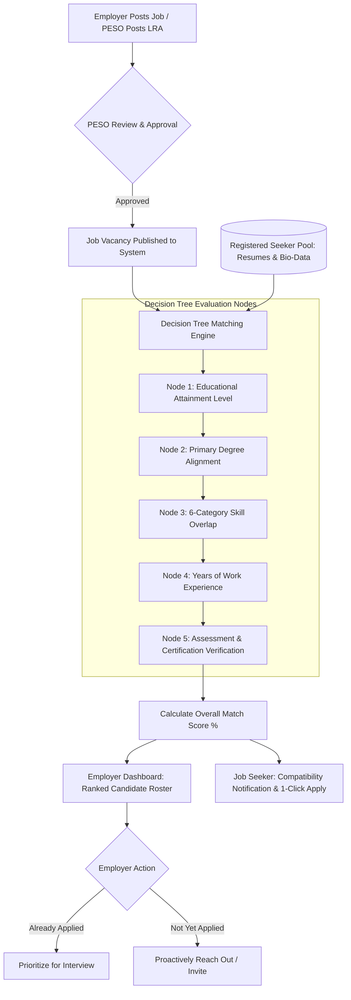
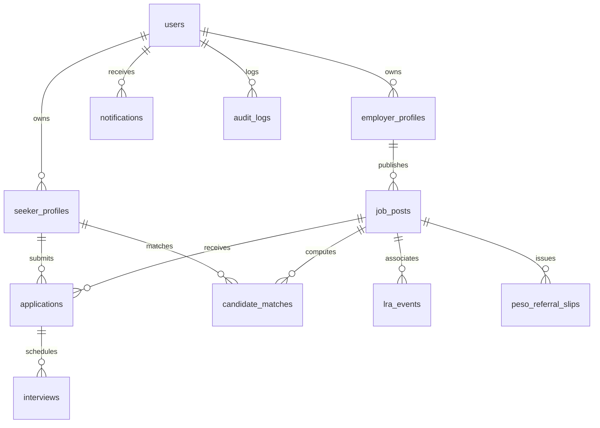

# eHANAP — System Specification & Technical Roadmap

> **Official Thesis Title**: *E-Hanap: A Decision Tree-Based Cloud System for Intelligent Employment Matching and Facilitation*  
> **Program**: Bachelor of Science in Computer Science (BSCS IV - Group 1, Thesis 102)  
> **Researchers**: Margarette Faye G. Lomboy, Lhean Joyce B. Escalona, Regina M. Sacapaño  
> **Adviser / Professor**: Dr. John Edgar S. Anthony  
> **Client & Beneficiary**: Municipal Public Employment Service Office (PESO), Municipality of Roxas, Oriental Mindoro  
> **Database Architecture Directive (Panelist "Dexcem")**: Transition from Firebase/Firestore to **Supabase (PostgreSQL)**  

---

## 1. Thesis Problem Statement & Research Foundation

### 1.1 Local Context in Roxas, Oriental Mindoro
As established in the thesis manuscript (Lomboy et al., 2026), employment facilitation in Roxas relies on manual, fragmented methods—walk-in applications, physical bulletin board postings, social media posts, and informal referrals. This fragmentation results in:
1. **Job Seekers**: Difficulties identifying vacancies matching their qualifications, educational attainment, and skills.
2. **Local Employers**: Protracted recruitment cycles and lack of automated tools to screen and rank applicants against vacancy criteria.
3. **PESO Municipal Office**: Heavy administrative burden managing paper records, coordinating Walk-in Referrals, and facilitating **Local Recruitment Activities (LRA)** for external employers (e.g., Puregold Calapan Branch) without a centralized database or real-time labor market analytics.

### 1.2 Theoretical & Conceptual Framework
The system is built upon four foundational theories:
- **Decision Tree Theory**: Core classification algorithm providing deterministic evaluation across educational attainment, degree alignment, skills, and experience with $O(\log n)$ evaluation speed.
- **Technology Acceptance Model (TAM)**: Guiding UI/UX simplicity, perceived usefulness (PU), and perceived ease of use (PEOU) across diverse user backgrounds (from high school graduates/OSY to corporate HR).
- **Diffusion of Innovation (DOI) Theory**: Addressing localized municipal adoption among Roxas barangays.
- **Systems Theory (Input-Process-Output Model)**:
  - **Inputs**: Job seeker credentials (resumes for college graduates, bio-data for high school/OSY), employer vacancy requirements, and PESO regulatory compliance documents (Letter of Intent, Mayor's Business Permit, DTI/SEC, Sanitary Clearance, Fire Safety Clearance).
  - **Process**: Automated text extraction, Decision Tree classification, candidate ranking calculation, and data synchronization.
  - **Outputs**: Ranked candidate roster for employers, compatibility notifications for seekers, and municipal labor analytics for PESO.

---

## 2. Core Thesis Highlight: Automated Candidate Ranking Engine

The core contribution of this thesis is the **Automated Candidate Ranking Engine**:

### 2.1 Decision Tree Node Scoring Weights
The deterministic scoring formula evaluates candidates across five discrete criteria:

1. **Educational Attainment Rank ($W_{edu} = 25\%$)**:
   - Compares candidate's attainment (`High School` < `TVET / Vocational` < `Associate` < `Bachelor's` < `Master's` < `Doctorate`) against vacancy minimum requirement.
   - Meets/exceeds = 100%; penalty applied per rank deficit.
2. **Degree Alignment ($W_{deg} = 20\%$)**:
   - Exact degree match = 100%.
   - Related field match (e.g., Computer Science $\leftrightarrow$ Information Technology; Accountancy $\leftrightarrow$ Business Administration; Hospitality $\leftrightarrow$ Tourism) = 80%.
   - Unrelated field = 40%.
3. **Skills Competency Overlap ($W_{skills} = 30\%$)**:
   - Evaluates across 6 vocational & technical domains:
     1. Trade & Technical Skills
     2. Administrative & Clerical Skills
     3. Service & Hospitality Skills
     4. Sales & Customer Support Skills
     5. IT, Digital & Creative Skills
     6. Agricultural & Mechanical Skills
   - Ratio of candidate skills to required + preferred vacancy skills.
4. **Work Experience Delta ($W_{exp} = 15\%$)**:
   - Compares verifiable years of experience to vacancy requirement.
5. **Verified Skill Assessments & Certifications ($W_{cert} = 10\%$)**:
   - Bonus weighting for skills validated via standardized assessments or uploaded TESDA/government certificates.

---

## 3. User Roles & System Workflows

### 3.1 Role 1: Job Seeker
- **Multi-Credential Ingestion**: Upload formal PDF/DOCX resumes (college graduates) or structured bio-data (high school graduates and Out-of-School Youth).
- **ATS Resume Analysis**: Instant feedback on ATS readability, keyword density, and missing sections.
- **Match Alerts**: Real-time push/toast notifications when an approved job matches $\ge 70\%$.
- **One-Click Application & Tracking**: Seamless application with real-time status tracker (`applied` $\to$ `ats_screened` $\to$ `under_review` $\to$ `for_interview` $\to$ `hired`).

### 3.2 Role 2: Local Roxas Employer
- **Compliance Upload**: Mandatory BPLO Mayor's Permit, DTI/SEC registration, and sanitary/fire clearances for Roxas accreditation.
- **Job Vacancy Posting**: Submission with structured requirements (educational attainment, preferred degree, required skills, salary range).
- **Automated Candidate Ranking Roster**:
  - Live candidate table automatically sorted by descending match score.
  - Transparent match explanation cards (why candidate scored 92% vs 65%).
  - Proactive invitation tools to reach out to unapplied high-match candidates.
- **Interview & Hiring Pipeline**: Schedule face-to-face or video interviews and issue digital job offers.

### 3.3 Role 3: PESO / LGU Admin
- **Regulatory Gatekeeping**: Verify business permits and accredit Roxas employers.
- **Job Moderation**: Review and approve job postings before public visibility.
- **Local Recruitment Activity (LRA) Coordination**: Handle external employers (e.g., Puregold Calapan) recruiting within Roxas; manage interview schedules and Roxas candidate pools.
- **Walk-in Encoding & Referral Slips**: Digitize physical walk-in applicants and issue official PESO Referral Slips.
- **Municipal Labor Analytics Dashboard**: Live metrics on municipality employment growth, active vacancies, barangay distribution, and skill gap heatmaps.

---

## 4. Technical Architecture: Supabase Migration Specification

Per thesis panel directive (*"dexcem"*), eHANAP is migrating from Firebase Firestore to **Supabase (PostgreSQL)**.

### 4.1 Supabase Relational Schema

#### Core PostgreSQL Tables:
1. `users`: Auth identities, roles (`admin`, `employer`, `job_seeker`), verification status.
2. `employer_profiles`: Roxas business registration details, establishment type (`local_established` vs `new_external`), permit file paths.
3. `seeker_profiles`: Personal details, barangay (Roxas), educational attainment, primary degree, skills arrays across 6 domains, experience years, resume/bio-data URLs.
4. `job_posts`: Title, requirements, degree, skills, salary, moderation status (`pending_approval`, `active`, `closed`, `rejected`), LRA flags.
5. `applications`: Application lifecycle status, cover notes, match score at time of application.
6. `candidate_matches`: Pre-computed Decision Tree scores (`overall_match`, `education_score`, `degree_score`, `skills_score`, `matched_reasons`, `missing_qualifications`).
7. `interviews`: Interview scheduling, type (`face_to_face`, `video`, `phone`), venue/link, status.
8. `lra_events`: External company details (e.g., Puregold Calapan), Roxas venue, dates, target quota.
9. `peso_referral_slips`: Official PESO referral documents issued to walk-in applicants.
10. `notifications`: Real-time user notifications.
11. `audit_logs`: Administrative compliance audit trail.

### 4.2 Storage Buckets
- `resumes`: Resumes and bio-data files.
- `compliance-documents`: Mayor's Permits, DTI/SEC registrations, Sanitary clearances.
- `avatars`: User photos and business logos.

---

## 5. Phased Implementation Roadmap

* **Milestone 1**: Supabase Database Architecture, Relational Schema & Client Layer
* **Milestone 2**: Multi-Role Authentication, Authorization & Session Management
* **Milestone 3**: End-to-End Data Pipeline & Bidirectional Sync ("Pagbato ng Data")
* **Milestone 4**: Automated Candidate Ranking & Two-Way Matching Engine
* **Milestone 5**: PESO / LGU Admin Portal: LRA Management & Municipal Analytics
* **Milestone 6**: UI / UX Modernization & Defense-Ready Design Polish
* **Milestone 7**: Platform Hardening, End-to-End Testing & Thesis Defense Readiness
