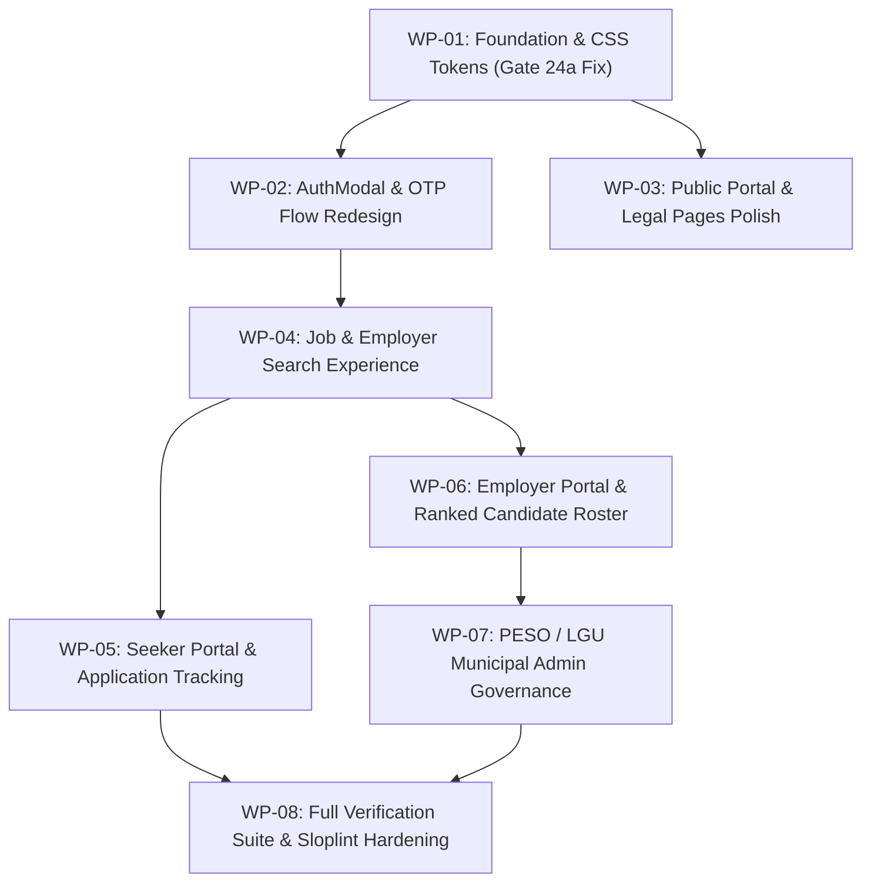

# eHANAP — Hallmark Redesign Implementation Spec Plan

> **For agentic workers:** REQUIRED SUB-SKILL: Use `superpowers:subagent-driven-development` (recommended) or `superpowers:executing-plans` to implement this plan task-by-task. Steps use checkbox (`- [ ]`) syntax for tracking.

**Goal:** Execute a comprehensive, multi-role Hallmark Redesign for the **eHANAP** employment facilitation platform (Municipality of Roxas, Oriental Mindoro), transitioning all public and authenticated app screens to the **Furrow** ledger design system, eliminating static sloplint failures, enforcing 4-state data regions and 8-state interactive controls, while preserving 100% of the underlying business logic, Decision Tree candidate ranking math, Supabase authentication pipelines, and 424/424 regression tests.

**Architecture:**
1. **Foundation & Token Enforcement:** Fix Gate 24a spacing violations in `src/index.css`, enforce strict OKLCH Furrow tokens (`tokens.css`), and ensure clean sloplint baseline across the codebase.
2. **Identity & Access Surfaces:** Redesign `AuthModal.tsx` into a high-density, high-craft municipal authentication modal supporting 6-digit email OTP (registration and password recovery), Google OAuth, and offline demo persona quick-switching.
3. **App Screen Densification (`flow.md` § App screens):** Recompose internal dashboards (Job Seeker, Employer, PESO Admin) from loose cards into ledger tables, tabular numerical displays, 32–40px control heights, and 4-state data containers (loading skeleton, empty action, error fallback, full content).
4. **Signature Candidate Ranking Interface:** Elevate the core thesis invariant—the **Automated Candidate Ranking Roster**—into a transparent, explainable 5-node ledger displaying exact compatibility scores (0–100%) and decision-tree breakdowns.
5. **Municipal Governance & LRA Tools:** Redesign PESO business accreditation, vacancy moderation queues, and municipal recruitment referral slip management with official municipal field-record clarity.

**Tech Stack:** React 19, TypeScript, Tailwind CSS v4, Motion 12, Lucide React, Supabase Client (`@supabase/supabase-js`), Hallmark Tooling (`sloplint.mjs`, `theme.mjs`).

**Spec & Context References:**
- [SPEC.md](file:///home/keil/eHANAP/SPEC.md) — Supabase Native Authentication, Email OTP & Google OAuth.
- [AGENT.md](file:///home/keil/eHANAP/AGENT.md) — Municipal PESO Roxas Mandate & Candidate Ranking Invariants.
- [PROGRESS.md](file:///home/keil/eHANAP/PROGRESS.md) — Architecture & Auth Baseline Progress.
- [.hallmark/log.json](file:///home/keil/eHANAP/.hallmark/log.json) — Furrow Theme Build Record (`Narrative Workflow`, `light/grotesk-sans/warm`).

---

## 1. Executive Summary & Inferred Context

```
Jurisdiction:   Municipality of Roxas, Oriental Mindoro, Philippines
Supervision:    Public Employment Service Office (PESO) & Local Government Unit (LGU)
Theme:          Furrow (deal 1/3, light/grotesk-sans/warm, committed posture)
Display Face:   Red Hat Display (roman, tight tracking)
Body Face:      Red Hat Text (500/600 weights, sentence case)
Figures Face:   Red Hat Mono (tabular lining numerals)
Palette:        Warm cream paper (oklch 96% 0.011 85), umber ink (oklch 18% 0.006 60),
                terra cotta accent (oklch 70% 0.19 40), cartographic contour/water/hedge accents
Redesign Depth: Full Redesign (content and wiring stay; layout system and composition elevated)
```

### 1.1 Inferred Personas & Workflows
1. **Job Seekers:** Local Roxas residents and youth. Authenticate via 6-digit email OTP or Google OAuth; complete profile bio-data; receive automated compatibility notifications; submit parsed resumes; track application lifecycle.
2. **Employers:** Verified Roxas businesses and accredited regional LRA partners (e.g. Puregold Calapan). Undergo PESO document accreditation (Mayor’s Permit from BPLO, DTI/SEC registration, fire/sanitary inspection); submit job posts for PESO approval; access the **Automated Candidate Ranking Engine** to recruit top-compatibility talent.
3. **PESO / LGU Administrators:** Municipal employment monitors approving job vacancies; verifying employer legal compliance; scheduling Local Recruitment Activities (LRA); issuing official municipal referral slips; monitoring barangay labor metrics and Hired-On-The-Spot (HOTS) tallies.

### 1.2 Core Thesis & Algorithmic Invariants
- **Candidate Compatibility Ranking:** Strict 5-node deterministic scoring:
  1. *Educational Attainment* (25%)
  2. *Degree Alignment* (20%)
  3. *Skills Competency* (30%)
  4. *Work Experience* (15%)
  5. *Verified Credentials / Certifications* (10%)
- **Dual-Mode Offline Fallback:** Unconditional academic defense resilience via `isSupabaseConfigured()`. Master OTP `123456`, demo personas (`Maria Santos`, `Mindoro Harvest`), and 0 network failures when internet is unavailable.
- **Strict Verification Boundaries:** User identity OTP (`AuthModal.tsx`) must remain completely decoupled from institutional PESO employer accreditation (`AdminVerificationsPage.tsx`).

---

## 2. Hallmark Baseline Audit & Sloplint Triage

### Current Audit Findings
- **Gate 24a (Floor — FAIL):** `src/index.css:104, 107` contains raw `0.5rem` values inside `max(0.5rem, env(safe-area-inset-*))` within `.safe-pb` and `.safe-pt`. Must be replaced with `var(--space-xs)`.
- **App Screen Scope (`flow.md` § App screens):** Internal pages (`JobSearchPage.tsx`, `EmployerSearchPage.tsx`, `JobDetailPage.tsx`, seeker/employer/admin dashboards) currently mix legacy Tailwind default utility colors (e.g., generic `indigo-600`, `blue-500`) with incomplete interactive states and un-densified card layouts.
- **Card Tells (Gate 3):** Repeated card grids with centered icon-above-heading tiles in dashboard overviews require conversion to ruled tabular ledgers and dense stat rows with tabular figures.
- **Interactive States (Gate 26b, 39a):** Ensure all inputs and buttons feature all 8 standard states (default, hover, `:focus-visible`, `:active`, disabled, loading, error, success) with invariant 48px heights on public pages and 32–40px heights on app screens.

---

## 3. Work Package Roadmap



| Priority | ID | Work Package | Target Scope | Key Deliverables |
| :---: | :---: | :--- | :--- | :--- |
| **1** | **WP-01** | **Foundation, Token Integrity & Lint Zero-FAIL** | CSS architecture, Gate 24a fix, Furrow tokens | `src/index.css`, `src/tokens.css`, `src/base.css` |
| **2** | **WP-02** | **Authentication & Identity Modal Redesign** | Supabase OTP, Google OAuth, 8 states | `src/views/AuthModal.tsx`, `src/components/DemoPersonaPill.tsx` |
| **3** | **WP-03** | **Public Portal & Legal Presentation** | Landing page, Terms, Privacy | `src/views/LandingPage.tsx`, `src/views/PrivacyPage.tsx`, `src/views/TermsPage.tsx` |
| **4** | **WP-04** | **Job & Employer Search Experiences** | Scannable tables, filter ledgers | `src/views/JobSearchPage.tsx`, `src/views/JobDetailPage.tsx`, `src/views/EmployerSearchPage.tsx` |
| **5** | **WP-05** | **Seeker Portal & Application Tracking** | Seeker dashboard, ATS score review | `src/views/seeker/SeekerDashboard.tsx`, `src/views/seeker/SeekerApplicationsPage.tsx` |
| **6** | **WP-06** | **Employer Portal & Ranked Candidate Roster** | Signature Candidate Ranking Engine | `src/views/employer/EmployerDashboard.tsx`, `src/views/employer/EmployerCandidatesPage.tsx` |
| **7** | **WP-07** | **PESO / LGU Municipal Admin Governance** | Compliance verification, LRA, HOTS | `src/views/admin/AdminDashboard.tsx`, `src/views/admin/AdminVerificationsPage.tsx`, `src/views/admin/AdminLraPage.tsx` |
| **8** | **WP-08** | **Verification Test Suite & Defense Hardening** | Automated assertions, 0 sloplint FAIL | `scripts/verify-hallmark-redesign.ts`, regression suites |

---

## 4. Detailed Task Breakdown

### Task 1: Foundation, Token Integrity & Lint Zero-FAIL (WP-01)

**Files:**
- Modify: `src/index.css`
- Modify: `src/tokens.css`
- Test: `node ../DND/scripts/sloplint.mjs src/index.css --genre modern-minimal`

- [ ] **Step 1: Fix Gate 24a spacing violations in `src/index.css`**
Replace raw `0.5rem` values in `.safe-pb` (line 104) and `.safe-pt` (line 107) with `var(--space-xs)`.
- [ ] **Step 2: Ensure Furrow token completeness in `src/tokens.css`**
Verify that all OKLCH neutral steps (`--color-slate-*`), brand accents (`--color-indigo-*`), cartographic accents (`--color-contour`, `--color-water`, `--color-hedge`), and tabular fonts (`--font-mono`, `--font-outlier`) are fully exported under `@theme static`.
- [ ] **Step 3: Run static sloplint verification**
Execute sloplint over `src/index.css` to confirm 0 FAIL, 0 REFLEX, 0 WARN.

---

### Task 2: Authentication & Identity Modal Redesign (WP-02)

**Files:**
- Modify: `src/views/AuthModal.tsx`
- Modify: `src/components/DemoPersonaPill.tsx`
- Test: `npx tsx scripts/verify-auth-otp-oauth.ts`

**Design Principles:**
- Transform the modal into an official municipal identity verification portal in the Furrow ledger style.
- 48px control heights, instant 2px focus ring (`var(--color-focus)`), clear distinction between Seeker and Employer registration modes.
- Single Google OAuth button with official SVG logo and clean typography (Apple button verified absent).
- 6-digit OTP input boxes with tabular spacing (`--font-mono`), active timer countdown, and clear error recovery.
- Preserve 1-click demo persona quick-select for offline thesis evaluation without visual clutter.

- [ ] **Step 1: Recompose modal shell with Furrow ledger framing**
Implement `--color-paper-2` card surface, `--color-rule` hairlines, and Red Hat typography.
- [ ] **Step 2: Style 6-digit OTP inputs for Registration & Password Reset**
Format input fields with `--font-mono`, tabular numbers, clear focus states, and 60-second cooldown timer.
- [ ] **Step 3: Verify all 8 interactive states on form controls**
Ensure default, hover, focus, active, disabled, loading, error, and success states conform to Hallmark Gate 26b.
- [ ] **Step 4: Execute Auth test suite**
Run `npx tsx scripts/verify-auth-otp-oauth.ts` to assert all 56/56 auth assertions pass with zero regressions.

---

### Task 3: Public Portal & Legal Presentation Polish (WP-03)

**Files:**
- Modify: `src/views/LandingPage.tsx`
- Modify: `src/views/PrivacyPage.tsx`
- Modify: `src/views/TermsPage.tsx`
- Test: `node ../DND/scripts/sloplint.mjs src/views/LandingPage.tsx src/views/PrivacyPage.tsx src/views/TermsPage.tsx --genre modern-minimal`

**Design Principles:**
- `LandingPage.tsx`: Retain the existing Furrow Narrative Workflow shape while tightening copy to the ~450 word budget, verifying masthead navigation alignment, and polishing the live Decision Tree sample widget.
- `PrivacyPage.tsx` & `TermsPage.tsx`: Style using the Long Document macrostructure (`references/macrostructures/02-long-document.md`) with 45–65ch measure, ruled section divides, and official PESO Roxas colophon.

- [ ] **Step 1: Audit and tighten copy in `LandingPage.tsx`**
Ensure word budget remains within Gate 58 limits and button pairs link cleanly to updated `AuthModal`.
- [ ] **Step 2: Recompose `PrivacyPage.tsx` and `TermsPage.tsx`**
Apply strict typographic measure (`max-w-[65ch]`), tabular dates, and municipal legal clauses.
- [ ] **Step 3: Run sloplint on public views**
Verify 0 FAIL across all public pages.

---

### Task 4: Job & Employer Search Experience Redesign (WP-04)

**Files:**
- Modify: `src/views/JobSearchPage.tsx`
- Modify: `src/views/JobDetailPage.tsx`
- Modify: `src/views/EmployerSearchPage.tsx`
- Test: `npm test`

**Design Principles (`flow.md` § App screens):**
- Shift from floating cards to structured tabular ledgers: Job title, Employer (with Roxas verified badge), Barangay, Employment type, Salary range, and Compatibility score.
- Search & filter bar: 36px control heights, compact pill chips for Barangay selection (Dangay, Bagumbayan, San Mariano, Paclasan), and clear reset action.
- 4-state regions on search results:
  - *Loading:* Skeleton rows matching table column dimensions.
  - *Empty:* "No vacancies found in [Barangay]" with clear "Clear filters" action.
  - *Error:* Network/storage failure banner with retry trigger.
  - *Full:* Ruled ledger rows with hover lift and tabular compatibility percentage tags.

- [ ] **Step 1: Recompose `JobSearchPage.tsx` filter and table ledger**
Replace card grid with dense, responsive table view.
- [ ] **Step 2: Implement 4-state data rendering for vacancy queries**
Ensure skeleton, empty, error, and populated states render cleanly.
- [ ] **Step 3: Recompose `JobDetailPage.tsx`**
Structure job requirements, PESO accreditation metadata, and Decision Tree compatibility breakdown.
- [ ] **Step 4: Redesign `EmployerSearchPage.tsx`**
Build official municipal directory of accredited businesses with Mayor’s permit verification badges.

---

### Task 5: Seeker Portal & Application Tracking Redesign (WP-05)

**Files:**
- Modify: `src/views/seeker/SeekerDashboard.tsx`
- Modify: `src/views/seeker/SeekerApplicationsPage.tsx`
- Modify: `src/views/seeker/SeekerProfilePage.tsx`
- Test: `npm test`

**Design Principles:**
- Dashboard overview: Dense stat row (Active Applications, Average Compatibility Score, Verified Certifications, Referral Slips) using tabular figures (`--font-mono`), followed by recent activity ledger.
- Application tracker: Step progression using simple hairlines and text state indicators (`Applied` -> `Under Review` -> `Interview Scheduled` -> `Hired`).
- ATS Resume Screen view: Transparent score badge and actionable recommendations rendered in Furrow paper surfaces.

- [ ] **Step 1: Redesign `SeekerDashboard.tsx` stat row and activity ledger**
- [ ] **Step 2: Polish `SeekerApplicationsPage.tsx` application lifecycle ledger**
- [ ] **Step 3: Ensure all numerical scores use tabular figures (`font-mono`)**

---

### Task 6: Employer Portal & Ranked Candidate Roster (WP-06)

**Files:**
- Modify: `src/views/employer/EmployerDashboard.tsx`
- Modify: `src/views/employer/EmployerCandidatesPage.tsx`
- Modify: `src/views/employer/EmployerJobsPage.tsx`
- Test: `npm test`

**Design Principles:**
- **The Signature Screen:** The **Automated Candidate Ranking Roster** is the core thesis contribution of eHANAP. It must display candidate cards/rows sorted descending by match score (0–100%) with an expandable **5-Node Decision Tree Breakdown**:
  - Educational Attainment (25%)
  - Degree Alignment (20%)
  - Skills Competency (30%)
  - Work Experience (15%)
  - Verified Credentials (10%)
- Each node must show exact weighted contribution and explainable match rationale (e.g. "Civil Service Professional verified", "5 of 6 required domains").
- Job posting wizard: Clear PESO moderation notice and structured qualification inputs.

- [ ] **Step 1: Recompose Candidate Ranking Roster in `EmployerCandidatesPage.tsx`**
Build explainable 5-node compatibility drawer/table with tabular percentage scores.
- [ ] **Step 2: Redesign Employer Dashboard active vacancies ledger**
- [ ] **Step 3: Format Candidate Status progression controls**
Ensure all action buttons (Schedule Interview, Reject, Mark Hired) support 8 interactive states.

---

### Task 7: PESO / LGU Municipal Admin Governance (WP-07)

**Files:**
- Modify: `src/views/admin/AdminDashboard.tsx`
- Modify: `src/views/admin/AdminVerificationsPage.tsx`
- Modify: `src/views/admin/AdminLraPage.tsx`
- Modify: `src/views/admin/AdminAnalyticsPage.tsx`
- Test: `npm test`

**Design Principles:**
- Municipal administrative authority: High-density data tables, clear approval/rejection actions, and formal document inspection workflows.
- `AdminVerificationsPage.tsx`: Employer business document inspection ledger (Mayor's Permit, DTI/SEC registration, fire/sanitary inspection status).
- `AdminLraPage.tsx`: Local Recruitment Activity management, quota tracking, and official municipal referral slip issuance with printable view.
- Municipal Analytics: Recharts graphs styled with Furrow cartographic tokens (`--color-contour`, `--color-water`, `--color-hedge`, `--color-accent`), tabular counts, and Hired-On-The-Spot tallies.

- [ ] **Step 1: Redesign `AdminVerificationsPage.tsx` business document inspection ledger**
- [ ] **Step 2: Redesign `AdminLraPage.tsx` recruitment activity manager & referral slip generator**
- [ ] **Step 3: Polish `AdminAnalyticsPage.tsx` charts with Furrow palette mapping**

---

### Task 8: Comprehensive Verification & Defense Hardening (WP-08)

**Files:**
- Create: `scripts/verify-hallmark-redesign.ts`
- Test: Full execution suite

**Verification Gates:**
1. `node ../DND/scripts/sloplint.mjs src/index.css src/views/LandingPage.tsx --genre modern-minimal`: **0 FAIL, 0 WARN**.
2. `npx tsx scripts/verify-auth-otp-oauth.ts`: **56/56 assertions passing**.
3. `npm test`: **424/424 regression assertions passing across all 8 suites**.
4. `npm run lint` (`tsc --noEmit`): **0 TypeScript compiler errors**.
5. `npm run build`: **Clean production bundle creation**.
6. Offline demo evaluation verified with master OTP code `123456` and demo personas.

- [ ] **Step 1: Write automated Hallmark verification script `scripts/verify-hallmark-redesign.ts`**
- [ ] **Step 2: Run complete platform test suite and capture output logs**
- [ ] **Step 3: Update `PROGRESS.md` with redesign verification evidence**

---

## 5. Review Focus & Failure Modes

1. **Thesis Defense Offline Invariant:** When internet connectivity is absent during presentation, demo personas and master code `123456` must continue to work flawlessly. No component may assume an active network connection.
2. **Decision Tree Weighting Invariance:** Mathematical weights (25/20/30/15/10) must remain completely untouched during UI restructuring.
3. **Verification Boundary Decoupling:** Institutional PESO business compliance verification must not cross into identity authentication OTP modals.
4. **Sloplint Zero-FAIL Compliance:** Gate 24a spacing tokens must be strictly observed in all CSS files.
5. **Backwards Compatibility:** All 48 components consuming `useApp()` or contextual hooks must continue to render without missing properties.
